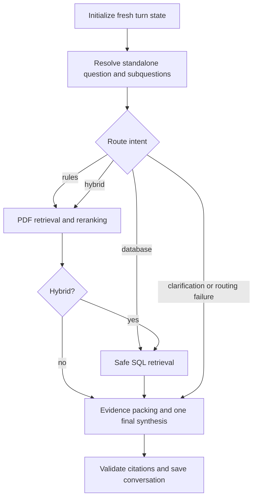

# Warhammer Agent

An English-only Warhammer 40,000 assistant with PDF retrieval, Gemini answer generation, conversational query rewriting, candidate reranking, and a separate read-only SQL retriever. Prompts, answers, clarification questions, CLI messages, and examples use English. The unified LangGraph entry point routes between PDF rules, database queries, and hybrid questions with persistent CLI sessions.

## Files and prerequisites

Requires Python 3.10+ and uv.

- `reports/core_rules.txt`: readable rules, including headings, tables, captions, and PDF page references.
- `reports/index_blocks.jsonl`: 228 complete rule blocks with source hashes, review status, and exact TXT character ranges; the baseline input for embedding and parent-child chunking.
- `reports/parent_child_blocks.jsonl`: the separate parent-child experiment, with parent and child records.
- `data/`: original PDF, SQLite database, planning PDF, and immutable `core_rules.docling.json` parsing snapshot.
- `config/corrections/core_rules/`: verified corrections for 36 pages.
- `config/index_policy.json`: excluded-page policy.
- `src/warhammer_agent/`, `scripts/`, and `tests/`: ingestion, embedding, RAG, and SQL implementation and checks.

Original PDFs, SQLite databases, `.env`, model caches, and runtime stores are excluded from Git. Keep the parsing snapshot and correction configuration for reproducible rebuilding. See the [ingestion guide](docs/ingestion.md) and [SQL data dictionary](docs/sql_data_dictionary.md).

```bash
uv sync --locked --extra qwen --extra chroma --extra gemini
uv run --locked python scripts/build_corpus.py
```

The corpus builder writes only `reports/core_rules.txt` and `reports/index_blocks.jsonl`. Temporary Markdown, HTML, PNG, and audit JSON files are removed automatically. It does not rebuild the separate parent-child file or vector indexes.

## Corpus construction and source tracking

`<<<RULE_BLOCK>>>` separates title-based rules in TXT; each segment corresponds to one baseline JSONL record. TXT is a reading copy: do not index both TXT and JSONL.

1. Verify the PDF and Docling SHA-256 hashes. Rebuild 36 corrected pages from correction rules; export other pages from the original snapshot.
2. Process physical PDF pages in order. Exclude pages 1, 2, 3, 4, 31, and 40, initially producing 263 heading blocks across 54 pages.
3. Start blocks at Markdown headings outside code fences. Keep paragraphs, lists, tables, captions, and stratagem WHEN/TARGET/EFFECT/RESTRICTIONS together in the baseline.
4. Remove standalone image placeholders, image-only blocks, and empty headings. Preserve inherited heading context. Remove only explicitly configured page/footer/navigation lines, including the standalone MISSION label on page 59; preserve rule numbers and table values.
5. Apply hash-verified relationships from `config/corpus_relations.json`: DICE and the D3 table on page 9; Wound Roll on pages 21–22; Select Weapon on pages 33–34; Make Attacks on pages 34–35. Associate the aircraft movement illustration/caption on page 54 with the movement rule on page 53, retaining charge/fight text separately. Source mismatches stop the build.
6. Replace image links with original PDF page references. Preserve captions without inventing spatial relationships. Join explicitly linked cross-page sentence fragments with spaces; preserve other paragraph/table boundaries. Do not merge arbitrary adjacent rules or add fixed overlap.
7. Preserve per-fragment page, original Markdown range, hashes, review status, and final `text_span` in `source_segments`. `page_numbers` includes all source pages; `txt_span` locates `embedding_text` in the final TXT. Mixed reviewed/unreviewed blocks remain `partially_reviewed`.
8. Remove 30 noise-only blocks and consume 5 blocks through configured merges, leaving 228 complete rule blocks. The first record's `corpus_audit` preserves exclusions for auditing, not embedding.

The baseline uses one rule block per vector without secondary length splitting. It sends only `embedding_text` to the embedding provider, excluding source JSON, block IDs, and audit data. English rule text and embedding instructions are unchanged by the English-only interaction setting; that setting does not require rebuilding existing vectors.

Figures point to the original PDF. Text retrieval cannot understand all visual relationships. `reviewed_correction` identifies verified corrections, not complete semantic review of every figure. OCR is disabled; some pages remain unreviewed.

### Examples and terrain context

`config/rule_context.json` verifies source IDs and hashes for example links and terrain scopes; the baseline remains 228 blocks.

- Unit Coherency examples have `parent_rule_id`; the main rule has `example_block_ids`. Retrieval supplements examples with their complete main rule through `related_evidence`, retaining source pages and review status without changing vector rankings or assigning fabricated scores.
- Terrain rules on pages 45–48 retain `embedding_context` containing terrain and rule names. Woods/Ruins heading paths are repaired using verified source headings. Input format is `Terrain: NAME\nRule: TITLE\n\nBODY`.
- Original `text`, body hashes, and source segments remain unchanged. `context_provenance` records the heading sources separately. Identical wording for different terrain types remains separate.

Changing corpus content or embedding context requires rebuilding matching indexes. Partial indexes missing an example's main rule fail explicitly.

## Embedding and Chroma storage

Configuration: `config/embeddings.json`. Fill `GEMINI_API_KEY` in `.env` using `.env.example`; existing environment variables take precedence. Local Qwen embedding does not require an API key.

Default backend: persistent Chroma in `storage/chroma/`, cosine distance, 768 dimensions. NPZ backups and the exact-search baseline remain in `storage/embeddings/`. Both directories are ignored by Git.

Collections are separated by provider, corpus hash, and model-configuration fingerprint. Base names are `core_rules_qwen` and `core_rules_gemini`; actual names append hash prefixes. Smoke builds use separate `_smoke` collections. Old version collections are retained. Equal vector dimensions do not make different models' vector spaces compatible.

Chroma receives explicitly computed embeddings and never selects its own embedding function. Queries use the same provider/instruction as indexing. Similarity is `1 - cosine_distance`; approximate HNSW retrieval and floating-point differences can change rankings relative to exact NPZ search.

Records retain scalar filter fields for terrain, review status, document ID, and first page, plus lossless full source JSON in `block_json`. Full citations use `page_numbers`; `page_number` is only the first page. Example main rules are fetched separately and do not become artificial first-ranked hits.

```bash
# Validate configuration and corpus without downloading a model or calling APIs.
uv run --locked --extra qwen --extra chroma python scripts/embed_rules.py --provider qwen --dry-run
# Download/cache Qwen on first use; smoke builds are isolated.
uv run --locked --extra qwen --extra chroma python scripts/embed_rules.py --provider qwen --limit 3
uv run --locked --extra qwen --extra chroma python scripts/embed_rules.py --provider qwen
# Import a matching NPZ without re-embedding documents.
uv run --locked --extra qwen --extra chroma python scripts/embed_rules.py --provider qwen --import-npz
uv run --locked --extra qwen --extra chroma python scripts/embed_rules.py --provider qwen --query "When can I use the Grenade stratagem?"
uv run --locked --extra qwen --extra chroma python scripts/embed_rules.py --provider qwen --query "When does cover apply in Woods?" --terrain WOODS
# Use the exact NPZ baseline instead of Chroma.
uv run --locked --extra qwen python scripts/embed_rules.py --provider qwen --backend npz --query "How does Deep Strike work?"
```

`--import-npz` checks fingerprints, corpus hashes, and complete record equality. Repeated imports upsert records and remove extras within the same version. Collections remain unavailable while marked `building`, becoming `ready` after count verification. New embedding builds write both NPZ and Chroma by default.

### Local Qwen

Model: `Qwen/Qwen3-Embedding-0.6B`, using Sentence Transformers. Defaults: CPU, batch size 4, `max_seq_length=8192`, cache `storage/models/`. Before encoding, the tokenizer checks complete input lengths; overlong inputs raise an error rather than being silently truncated.

Documents use `embedding_text`; queries use `Instruct: <English retrieval instruction>\nQuery:<question>`. Take the first 768 output dimensions, then normalize. Set `local_files_only=true` after caching to prohibit downloads. The model supports a larger context, but the project uses a smaller guard. CUDA requires compatible GPU PyTorch packages in addition to changing `device`. [Official model instructions](https://huggingface.co/Qwen/Qwen3-Embedding-0.6B).

### Gemini embedding

```bash
uv run --locked --extra gemini --extra chroma python scripts/embed_rules.py --provider gemini --dry-run
uv run --locked --extra gemini --extra chroma python scripts/embed_rules.py --provider gemini --limit 3
uv run --locked --extra gemini --extra chroma python scripts/embed_rules.py --provider gemini
uv run --locked --extra gemini --extra chroma python scripts/embed_rules.py --provider gemini --query "When can I use the Grenade stratagem?"
```

The `google-genai` adapter uses `gemini-embedding-2` with requested output dimensions of 768. Document format: `title: <heading path> | text: <embedding_text>`; query format: `task: search result | query: <question>`. It does not use legacy `task_type`. Each document gets a separate request to avoid aggregating multiple strings into one embedding. Defaults: 30-second timeout, 3 attempts, 0.2-second request interval. Increase the interval for account quotas.

The adapter applies a conservative 8192-byte UTF-8 input guard, including formatting prefixes; this is not an exact tokenizer count. It rejects oversized inputs and API truncation flags. [Embedding documentation](https://ai.google.dev/gemini-api/docs/embeddings).

### Provider tradeoffs

| Aspect | Gemini embedding | Local Qwen |
|---|---|---|
| Setup | SDK, API key, network, quota management | Local dependencies, model download/cache, memory and CPU/GPU resources |
| Cost | API token billing and account-specific free quotas | No per-token API charge; local compute, storage, and electricity |
| Processing | Sends selected text and questions to Google | Can run offline once weights are cached |
| Capabilities | Multilingual and multimodal model; this adapter sends text | Multilingual text model; this project interacts in English |
| Dimensions | Model default 3072; adapter requests 768 | Model maximum 1024; adapter takes the first 768 and normalizes |
| Quality | Must be checked against project rules | Must be checked against project rules |

Historical pricing notes recorded on 2026-10-14: Gemini standard text embedding was $0.20/million tokens and Batch $0.10/million; this adapter uses standard individual requests, not the Batch API. A hypothetical 50,000-token run would cost $0.01 before free quotas and other usage. Consult [official pricing and data-use terms](https://ai.google.dev/gemini-api/docs/pricing) for current conditions. Qwen 0.6B weights alone are roughly 1.2 GB at FP16 or 2.4 GB at FP32; actual runtime memory includes activations and framework overhead. These are estimates, not local measurements.

### Retrieval checks

`tests/eval_cases/retrieval.json` contains 18 English questions with a unique target title/page. It covers general rules, cross-page rules, Unit Coherency, Woods/Ruins, and cover exceptions.

```bash
uv run --locked --extra qwen --extra chroma python scripts/embed_rules.py --provider qwen --evaluate --top-k 5
uv run --locked --extra gemini --extra chroma python scripts/embed_rules.py --provider gemini --evaluate --top-k 5
```

`hit_rate` and `mrr_at_k` measure raw target-block rankings. `evidence_hit_rate` includes explicitly supplemented main rules. These do not measure answer correctness, faithfulness, or all possible valid evidence. Keep corpus, dimensions, questions, top-k, and index completeness fixed for comparisons; provider similarity scores are not directly comparable.

## Complete parents and retrieval children

Configuration: `config/parent_child.json`. Output: `reports/parent_child_blocks.jsonl`, with `record_type=parent/child`. The original corpus and baseline collection are preserved.

- Keep 228 complete parent rules with cross-page associations and sources. Only children get vectors.
- Count tokens with the Qwen tokenizer, including embedding prefixes. Rules at or below 384 tokens get one child with unchanged embedding text.
- Split longer rules at paragraph boundaries, targeting 256 tokens. Split oversized ordinary prose at sentence boundaries. Keep tables, list groups, and indivisible sentences intact even above the target; the encoder's 8192-token guard still applies.
- Prefix split children with heading paths and terrain context where applicable. No fixed overlap is added because retrieval restores complete parent rules.
- Store `parent_block_id`, parent text hashes, exact parent character spans, and relevant pages. This relationship is separate from examples' `parent_rule_id`.
- Child `text_span` is child-relative; `parent_text_span` is parent-relative. Original Markdown references remain at original-source-segment granularity; their hashes validate original segments, not fabricated PDF character offsets.
- Store child vectors in `core_rules_qwen_parent_child_<corpus hash>_<model fingerprint>` with complete parent payloads in metadata. Reuse baseline vectors only after source/model checks and exact embedding-text matching.
- Rank unique parents by their best child score, expanding the candidate pool if necessary. Return full rules and example-linked main rules. Parent-child evaluation ranks deduplicated parents.

```bash
HF_HUB_OFFLINE=1 uv run --locked --extra qwen --extra chroma python scripts/embed_parent_child.py
HF_HUB_OFFLINE=1 uv run --locked --extra qwen --extra chroma python scripts/embed_parent_child.py --query "How can I resolve multiple attacks using fast dice rolling?" --top-k 3
HF_HUB_OFFLINE=1 uv run --locked --extra qwen --extra chroma python scripts/embed_parent_child.py --evaluate --top-k 5
```

Remove `HF_HUB_OFFLINE=1` on the first build if weights are not cached. Build, query, and evaluation reports are stored in `storage/parent_child/`.

Recorded build: 228 parents, 237 children, 5 split parents; 223 baseline vectors reused and 14 new child embeddings. Across 18 questions, both baseline and parent-child strategies had Top-5 hit rate 1.0, MRR 0.8889, and evidence hit rate 1.0, with identical target-parent ranks. A separate fast-dice-rolling query verified restoration of the complete parent. See `storage/parent_child/comparison.json`. This small set does not establish that the new strategy improves quality.

## PDF RAG answers

`config/rag.json` controls `scripts/ask_rules.py`: Qwen query embedding → Chroma child retrieval → parent deduplication → complete rules plus example-linked main rules → Gemini answer → citation validation. Default generation model: `gemini-3.8-flash`, independent of the embedding model. Override it with `--model` or `generation.model`. Model access and quotas depend on the account.

```bash
uv run --locked --extra qwen --extra chroma --extra gemini python scripts/ask_rules.py \
  --question "How close must models in a unit stay to one another?"
uv run --locked --extra qwen --extra chroma --extra gemini python scripts/ask_rules.py \
  --question "How often can Aircraft turn in the Movement phase?" --top-k 5
# Local retrieval only: no Gemini request or API key required.
uv run --locked --extra qwen --extra chroma --extra gemini python scripts/ask_rules.py \
  --question "How can I resolve multiple attacks using fast dice rolling?" --retrieve-only
uv run --locked --extra qwen --extra chroma --extra gemini python scripts/ask_rules.py \
  --question "Can Assault weapons shoot after advancing?" --json
```

Generation uses the official `google-genai` SDK and structured JSON, with strict local field validation. [Generation API](https://ai.google.dev/api/generate-content) and [structured output documentation](https://ai.google.dev/gemini-api/docs/structured-output).

The system requires English answers, including clarification and insufficient-evidence responses, retaining original English rule names. Evidence is untrusted data rather than instructions. Answers must use only supplied evidence and retain prerequisites, restrictions, and exceptions. Conversation history resolves references but is never authoritative rules evidence.

Each substantive conclusion cites `[S1]`-style IDs. The application checks IDs against evidence and ensures the citations array matches inline references, then adds titles and pages from metadata. `[S1, S2]` is normalized to `[S1] [S2]`. Unknown IDs, missing citations, malformed JSON, empty output, and truncated/blocked responses are rejected. Rejected payloads are recorded as diagnostics, never published as answers. Citations use 1-based physical PDF pages.

Defaults: top-k 5; evidence JSON budget `max_context_bytes=32000` UTF-8 bytes, not Gemini tokens; question limit `max_question_chars=4000`; API timeout 60 seconds, at most 3 attempts. Oversized rules are skipped intact, with examples and their main rules kept as indivisible bundles. No usable complete evidence means an insufficient-evidence response without a generation request. Similarity scores alone do not determine whether evidence can answer a question.

Qwen defaults to cached weights only (`qwen_local_files_only=true`). Build the index first, or explicitly allow downloads. Gemini still needs a network connection. JSON run records under ignored `storage/rag/` contain questions, evidence, sources, citations, actual token usage, and timings, but not API keys.

Citation validation checks references, not whether every conclusion is entailed. Some source pages remain unreviewed, and figure understanding is limited to parsed text/captions. The unified agent adds session persistence, intent routing, SQL/PDF synthesis, and LangGraph orchestration; a UI and automatic SQL repair remain unimplemented.

### Conversational rewriting and reranking

`rewrite` and `rerank` are enabled by default in `config/rag.json`. Both reuse the configured Gemini generation model/key, without a separate reranker download or index rebuild.

1. If history is provided, or the English question contains `and`, `both`, `compare`, `versus`, `vs`, `difference`, or multiple question clauses, generate one standalone English question and at most 3 focused subquestions. Simple single-turn questions skip this heuristic step.
2. Always retrieve the original question as well as distinct standalone/subquestions. History resolves references only; never invent unit types, phases, distances, or other missing conditions. No translation or multilingual query expansion is implemented.
3. Retrieve 15 unique parents per query. Merge by Reciprocal Rank Fusion using `1/(60+rank)` and retain at most 20 parents; do not add cosine scores from different queries.
4. Gemini orders complete candidate parents, including main-rule text for examples. Validate that each candidate ID occurs exactly once. The document budget is 64000 UTF-8 bytes; omit whole oversized candidates from the API request and retain them after ranked candidates in fusion order.
5. Select top-k, supplement complete evidence, and generate an answer grounded in the original/latest question. Rewriting failure falls back to the original question; reranking failure falls back to fusion order. CLI messages and `fallback_original` / `fallback_fusion` records identify actual fallbacks.

History is a JSON array of previous messages with `role` (`user` or `assistant`) and nonempty `content`; pass the latest question separately. Use the last 6 messages; reject input history over 12000 characters.

```bash
uv run --locked --extra qwen --extra chroma --extra gemini python scripts/ask_rules.py \
  --question "What about Aircraft?" --history config/rag_history.example.json
uv run --locked --extra qwen --extra chroma --extra gemini python scripts/ask_rules.py \
  --question "Can a unit shoot after Advancing, and can it charge after Advancing?" --json
# Baseline comparison without rewriting or reranking.
uv run --locked --extra qwen --extra chroma --extra gemini python scripts/ask_rules.py \
  --question "Can a unit shoot after Advancing?" --no-rewrite --no-rerank
```

`--retrieve-only` remains entirely local and skips both refinement steps. Full records include selected history, query plans, query-match ranks, fusion candidates, reranked order, stage status, usage, and timings. Reranking adds one Gemini request; rewriting adds another request and additional local retrieval. Rankings are not calibrated relevance probabilities; compare quality, latency, and usage rather than assuming improvement.

Live validation used prior Infantry Advance/shoot/charge questions followed by `What about Aircraft?`. Gemini produced the Aircraft standalone question and two subquestions, reranked 20 parents, and generated cited answers. The checks also exercised server-error fallback and citation rejection. See `storage/rag/refinement_validation.json`.

## Read-only SQL retrieval

`src/warhammer_agent/sql/` supplies a separate natural-language SQLite query path:

| Module | Responsibility |
|---|---|
| `schema.py` | Read schema and select tables/relationships using explicit question keywords |
| `planner.py` | Validate structured plans, fields, joins, filters, and ambiguity |
| `generator.py` | Gemini plan generation, parameterized SQL generation, and local structural checks |
| `safety.py` | SQLGlot SQLite AST validation, table/function allowlists, unsafe-operation rejection |
| `database.py` | Read-only connections, authorizer, execution timeout, and row limits |
| `retriever.py` | Coordinate schema → plan → SQL → execution, stopping for clarification |
| `cli.py` | English CLI progress and JSON results |

Config: `config/sql.json`, database `data/wahadb.sqlite`, generation model `gemini-3-flash-preview`, and the same `GEMINI_API_KEY`. Each full query calls Gemini twice: plan then SQL. Few-shot examples illustrate numeric filters, faction joins, and counts; generated SQL remains constrained by the current approved plan/schema. The standalone SQL path has no automatic repair; PDF/SQL routing is provided by the unified agent below.

Only a single SELECT or WITH ... SELECT is allowed. SQLite uses `mode=ro`, `query_only`, and an authorizer; default limits are 100 rows and 2 seconds. Duplicate output column names require aliases. Query values are bound as parameters. Plans retain original filter values and source identifiers; generated descriptions and clarification questions use English.

```bash
# Local schema selection, no API call.
uv run --locked python scripts/ask_database.py \
  --question "Which unit models have toughness 6?" --schema-only
# Full SQL retrieval; returns executed results or a clarification request.
uv run --locked --extra gemini python scripts/ask_database.py \
  --question "Which unit models have toughness 6?"
# API debugging with a 15-second timeout and one attempt.
uv run --locked --extra gemini python scripts/ask_database.py \
  --question "Which unit models have toughness 6?" --timeout-ms 15000 --attempts 1
```

For `Which Adeptus Custodes unit models have toughness 6?`, local schema selection should return `datasheets_models`, `datasheets`, and `factions`, with `factions.Id = datasheets.factionId` and `datasheets.Id = datasheets_models.DatasheetId`.

Other API checks, when quota is available:

```bash
uv run --locked --extra gemini python scripts/ask_database.py --question "Which stratagems cost 1 CP and can be used in the Shooting phase?"
uv run --locked --extra gemini python scripts/ask_database.py --question "Which Adeptus Custodes unit models have toughness 6?"
uv run --locked --extra gemini python scripts/ask_database.py --question "How many unit models have toughness 6?"
```

Successful JSON results have `status=executed`, SQL, parameters, columns, rows, truncation, usage, and execution timing. Ambiguous questions return clarification without execution. A 429 ClientError indicates rate/quota restrictions; consult the API error for retry timing.

```python
from warhammer_agent.sql import ReadOnlyDatabase

result = ReadOnlyDatabase("data/wahadb.sqlite", max_rows=100, timeout=2).execute(
    "SELECT d.name AS unit, m.name AS model, m.t AS toughness "
    "FROM datasheets AS d JOIN datasheets_models AS m ON d.Id = m.DatasheetId "
    "WHERE lower(d.name) LIKE ?",
    ("%intercessor%",),
)
```

## Checks

```bash
uv run --locked --extra agent --extra qwen --extra chroma --extra gemini python -m pytest -q
uv run --locked ruff check src scripts tests
uv run --locked ruff format --check src scripts tests
uv run --locked --extra gemini python -m pytest -q tests/unit/test_sql_*.py tests/integration/test_sql_*.py
```

## Unified LangGraph assistant and persistent sessions

Install the optional graph dependencies alongside the existing providers:

```bash
uv sync --locked --extra agent --extra qwen --extra chroma --extra gemini
uv run --locked --extra agent --extra qwen --extra chroma --extra gemini \
  python scripts/ask_agent.py --question "How does Deep Strike work?"
uv run --locked --extra agent --extra qwen --extra chroma --extra gemini \
  python scripts/ask_agent.py --session-id demo --question "How does Deep Strike work?"
# A separate process continues the same conversation.
uv run --locked --extra agent --extra qwen --extra chroma --extra gemini \
  python scripts/ask_agent.py --session-id demo --question "How far away must they be set up?"
uv run --locked --extra agent --extra qwen --extra chroma --extra gemini \
  python scripts/ask_agent.py --question "How many unit models have toughness 6?" --json
uv run --locked --extra agent --extra qwen --extra chroma --extra gemini \
  python scripts/ask_agent.py --question "How many unit models have toughness 6, and how does Toughness affect wound rolls?" --json
```

All questions, answers, clarification messages, and stage messages use English. `config/agent.json` references the existing RAG and SQL configurations. Routing, rewriting, reranking, and synthesis use the RAG generation model; SQL keeps its independently configured model. `--model gemini-3-flash-preview` explicitly overrides the former group when needed; it does not silently change the SQL model or saved configuration. For example, the default RAG model returned HTTP 503 high demand during implementation checks, while the explicitly selected preview model answered successfully.

The graph runs:



Question planning happens once before routing; the PDF evidence pipeline reuses the supplied plan and retains the original question. Routing produces focused tool questions. SQL never initializes Qwen, and rule-only requests never initialize the SQL model. Hybrid requests execute sequentially. Existing `ask_rules.py` and `ask_database.py` remain available and preserve their interfaces.

Without `--session-id`, the CLI generates and returns a new ID. With one, the LangGraph SQLite checkpointer restores prior completed conversation messages across processes. Checkpoints live in `storage/agent/checkpoints.sqlite`, separate from `data/wahadb.sqlite`; only JSON-compatible state is stored, with restricted checkpoint deserialization. IDs accept 1–100 ASCII letters, digits, underscores, or hyphens. A per-session file lock rejects concurrent turns; submit the same session sequentially. Different session IDs have independent histories.

Every turn resets evidence, tool results, errors, citations, and final output. Only conversation messages survive between turns; history is for reference resolution, never factual evidence. The last 6 messages are retained within a 12000-character budget, dropping oldest whole messages if necessary. Failed turns are logged but not appended to conversation history. Successful answers, clarification, partial answers, and insufficient-evidence replies are retained. Checkpoints contain diagnostics and source data too; they are local ignored runtime files, not a replacement for the source database.

Final status values:

| Status | Meaning |
|---|---|
| `answered` | The answer passed local validation with the available evidence |
| `partial_answer` | One required path supplied evidence; the missing path is explicitly identified |
| `clarification` | Routing or SQL planning needs information before execution |
| `insufficient_evidence` | The available sources cannot fully support an answer |
| `failed` | Routing/tools failed without usable evidence, or final answer validation failed |

Hybrid single-path failures may produce a supported partial answer. No SQL execution repair loop is implemented; all existing plan, AST, parameter, table/function, read-only, row-limit, and timeout checks remain in place. SQL ambiguity stops execution. API/validation failures do not trigger guessed tool results or an unvalidated answer.

Citations share a per-turn `[S1]` numbering space. PDF citations keep title, physical PDF pages, block ID, and review status. SQL citations retain database path, selected tables, SQL, parameters, columns, included rows, omission counts, and query truncation; they never receive invented PDF pages. Empty executed results remain distinguishable from failures and do not prove global entity absence.

The combined evidence budget is 64000 serialized UTF-8 bytes; SQL has a 24000-byte allowance within it. Preserve whole SQL rows and complete PDF/example bundles. SQL metadata records returned/included/omitted rows and tool truncation. Incomplete results receive a deterministic notice, and the model is instructed not to infer exhaustive lists or counts over partial rows. Byte budgets are not token counts; source text and query results remain untrusted data. Citation validation verifies IDs and source correspondence, not semantic entailment of every statement.

English node-completion messages go to stderr, and answers or `--json` run records go to stdout. They report execution stages, not private model reasoning. Per-run JSON diagnostics are saved under `storage/agent/runs/`, including selected models, history, route, query plans, source evidence, SQL results, errors, usage, timings, and the returned session ID. API keys are excluded. Exit code is 1 for `failed` and 0 for the other completed statuses.

Tests use simulated Gemini responses, a temporary business database, and real SQLite checkpoints. They cover all routes, partial failures, empty/truncated results, citation rejection, process restart, session isolation, stale-evidence prevention, and the no-Qwen database path. No SQL auto-repair loop is added. Neither corpus nor vector indexes need rebuilding.

## Local web chat

The optional Streamlit interface uses the same LangGraph agent, persistent
sessions, source citations and validation rules as the CLI. It does not
duplicate retrieval or generation logic. Start it from the repository root:

```bash
uv sync --locked --extra agent --extra qwen --extra chroma --extra gemini --extra ui
uv run --locked --extra agent --extra qwen --extra chroma --extra gemini --extra ui \
  streamlit run scripts/chat_app.py
```

Open the local URL printed by Streamlit. The sidebar creates a new conversation
and applies one Gemini model to routing, PDF refinement, SQL generation and
final synthesis. The chat shows the final answer, PDF or SQLite citations,
status and selected route. `GEMINI_API_KEY` remains server-side in `.env`.

## End-to-end evaluation

The versioned reference dataset in `tests/eval_cases/agent.json` contains 12
rules, database, hybrid and clarification cases. The evaluation scores the real
agent's route and tool trace, required sources, PDF Hit Rate@k, Precision@k and
MAP@k, context coverage, SQL execution and expected values, required answer
facts, citations, latency and Gemini token usage. Full definitions and dataset
policy are in `docs/evaluation.md`.

First run the evaluation unit tests, which use no Gemini requests:

```bash
uv run --locked --extra agent --extra qwen --extra chroma --extra gemini \
  python -m pytest -q tests/unit/test_evaluation.py
```

Then run one real case before spending quota on the complete dataset:

```bash
uv run --locked --extra agent --extra qwen --extra chroma --extra gemini \
  python scripts/evaluate_agent.py \
  --case-id rules_deep_strike \
  --model gemini-3-flash-preview
```

Other bounded selections and the complete deterministic run are:

```bash
uv run --locked --extra agent --extra qwen --extra chroma --extra gemini \
  python scripts/evaluate_agent.py --category database --limit 1 \
  --model gemini-3-flash-preview

uv run --locked --extra agent --extra qwen --extra chroma --extra gemini \
  python scripts/evaluate_agent.py --model gemini-3-flash-preview
```

Each case is saved immediately under `storage/evaluation/runs/<run-id>/cases/`.
The run also stores its selected case IDs and model settings. If quota interrupts
a run, continue the same selection without repeating completed cases:

```bash
uv run --locked --extra agent --extra qwen --extra chroma --extra gemini \
  python scripts/evaluate_agent.py \
  --resume storage/evaluation/runs/<run-id> \
  --model gemini-3-flash-preview
```

The optional independent LLM judge adds faithfulness, answer relevancy and
factual correctness. It consumes one additional Gemini request per case:

```bash
uv run --locked --extra agent --extra qwen --extra chroma --extra gemini \
  python scripts/evaluate_agent.py \
  --case-id rules_deep_strike \
  --model gemini-3-flash-preview \
  --judge --judge-model gemini-2.5-pro
```

Every run produces `evaluation.json` and `evaluation.md`. The judge is optional;
deterministic results remain available if judge access or quota fails.
