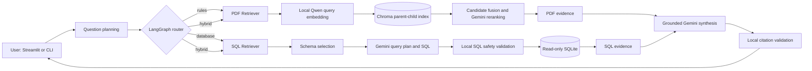

# System architecture

## Goal and sources

The assistant answers English Warhammer 40,000 questions using the two sources
required by the course:

1. `data/Core Rules.pdf` for general rules and mechanics;
2. `data/wahadb.sqlite` for structured unit, model, faction, weapon, detachment,
   ability, enhancement, and Stratagem records.

The system supports questions that require the PDF, the database, or both. It
does not use web search or unsupported model knowledge as factual evidence.

## Project layout

The repository follows a standard Python `src` layout. The tree below lists the
main user entry points and the files that define each pipeline; helper modules,
individual tests and generated runtime files are omitted for readability.

```text
warhammer-agent/
├── config/                                  # Versioned runtime configuration
├── data/                                    # Local PDF, SQLite and parsing sources
├── docs/                                    # Architecture and technical documentation
├── reports/                                 # Reviewed corpus and parent-child records
│
├── scripts/                                 # User-facing entry points
│   ├── chat_app.py                          # Start the Streamlit chat
│   ├── ask_agent.py                         # Query the unified LangGraph agent
│   ├── ask_rules.py                         # Query the standalone PDF RAG pipeline
│   ├── ask_database.py                      # Query the standalone SQL Retriever
│   ├── evaluate_agent.py                    # Run the end-to-end evaluation
│   ├── build_corpus.py                      # Rebuild the reviewed rule corpus
│   └── embed_parent_child.py                # Build or query the default vector index
│
├── src/warhammer_agent/
│   ├── ingestion/                           # PDF preparation and corpus construction
│   │   ├── parse.py                         # Create the immutable Docling snapshot
│   │   ├── clean.py                         # Apply reviewed page corrections
│   │   ├── corpus.py                        # Build source-checked rule blocks
│   │   └── validation.py                    # Validate hashes and source integrity
│   │
│   ├── embeddings/                          # Embeddings and vector persistence
│   │   ├── providers.py                     # Format and validate Qwen/Gemini vectors
│   │   ├── chroma_store.py                  # Manage versioned Chroma collections
│   │   └── parent_child.py                  # Parent-child chunking and parent restoration
│   │
│   ├── rag/                                 # PDF Retriever and grounded generation
│   │   ├── pipeline.py                      # Retrieve complete rules and pack evidence
│   │   ├── refinement.py                    # Rewrite queries and rerank candidates
│   │   └── generation.py                    # Generate and validate cited answers
│   │
│   ├── sql/                                 # Safe natural-language SQLite retrieval
│   │   ├── schema.py                        # Select relevant tables and relationships
│   │   ├── planner.py                       # Validate structured query plans
│   │   ├── generator.py                     # Generate parameterised SQL with Gemini
│   │   ├── safety.py                        # Validate generated SQLite syntax and scope
│   │   ├── database.py                      # Execute bounded read-only queries
│   │   └── retriever.py                     # Orchestrate plan, SQL and execution
│   │
│   ├── agent/                               # LangGraph multi-source orchestration
│   │   ├── graph.py                         # Define nodes, routing and graph execution
│   │   ├── services.py                      # Lazily initialise selected retrievers
│   │   ├── evidence.py                      # Pack PDF/SQL evidence and citations
│   │   └── session.py                       # Persist and isolate conversations
│   │
│   ├── evaluation/                          # End-to-end evaluation pipeline
│   │   ├── dataset.py                       # Load and validate frozen cases
│   │   ├── runner.py                        # Execute and resume real-agent cases
│   │   ├── metrics.py                       # Calculate deterministic metrics
│   │   └── report.py                        # Write JSON and Markdown reports
│   │
│   ├── credentials.py                       # Resolve session or environment API keys
│   └── ui.py                                # Present the agent through Streamlit
│
└── tests/
    ├── unit/                                # Isolated component tests
    ├── integration/                         # Cross-component and persistence tests
    └── eval_cases/                          # Frozen retrieval and agent datasets
```

## Runtime flow



Question planning and routing use Gemini through Google AI Studio. PDF retrieval
uses the local Qwen embedding model and a persistent Chroma index. SQL generation
uses Gemini, while SQLGlot validation and SQLite read-only controls enforce local
safety constraints. The final answer can cite PDF and database evidence in one
shared `[S1]` numbering space.

## Modules

| Module | Main responsibility |
|---|---|
| `ingestion` | Convert the PDF snapshot and reviewed corrections into 228 source-traceable rule blocks |
| `embeddings` | Build and query Qwen or Gemini vectors; persist compatible collections in Chroma |
| `rag` | Retrieve complete PDF rules, rewrite conversational questions, rerank candidates, and validate PDF answers |
| `sql` | Select relevant schema, generate a structured plan and parameterized SQL, validate it, and execute it read-only |
| `agent` | Plan once, route to the smallest required source set, combine evidence, synthesize, and persist sessions |
| `evaluation` | Run frozen rules, database, hybrid, and clarification cases; calculate deterministic metrics and reports |
| `ui.py` | Present the existing agent through Streamlit without duplicating retrieval or generation logic |

## Source selection

- **Rules:** general mechanics, Core Stratagems, timing, conditions, costs, and
  exceptions found in the Core Rules PDF.
- **Database:** stored profiles, keywords, factions, detachments, weapons,
  abilities, lists, filters, comparisons, and aggregates.
- **Hybrid:** a requested answer genuinely needs both a stored database fact and
  a general PDF rule.
- **Clarification:** a required unit, entity, or distinction is unresolved, so
  the system asks one focused question before executing a query.

## Persistence and local data

| Location | Content | Git status |
|---|---|---|
| `reports/` | Reviewed text corpus and parent-child records | versioned |
| `data/core_rules.docling.json` | Immutable parsing snapshot | versioned |
| `data/Core Rules.pdf` | Original course PDF | local |
| `data/wahadb.sqlite` | Course SQLite database | local |
| `storage/chroma/` | Persistent vector index | local |
| `storage/models/` | Cached Qwen weights | local |
| `storage/agent/` | LangGraph checkpoints and run diagnostics | local |
| `storage/evaluation/` | Resumable evaluation cases and reports | local |

## Safety and grounding

- Retrieved PDF text and SQL rows are treated as evidence, never instructions.
- SQL accepts only a validated single `SELECT` or `WITH ... SELECT`, uses bound
  parameters, opens SQLite read-only, and enforces table, function, row, and time
  limits.
- Answers must cite the exact supplied evidence IDs. Unknown, missing, or
  inconsistent citations are rejected locally.
- Conversation history resolves references but is not factual evidence.
- API keys are excluded from configuration, checkpoints, and run reports. The
  web UI keeps its explicit key only in the active Streamlit session.

## Verification

Local unit and integration tests cover parsing, corpus integrity, Chroma,
retrieval, SQL safety and execution, LangGraph routes and sessions, credentials,
the web UI, and evaluation metrics. The final live evaluation uses the frozen
12-case dataset in `tests/eval_cases/agent.json`; its results should be generated
only after the implementation and documentation structure are frozen.
